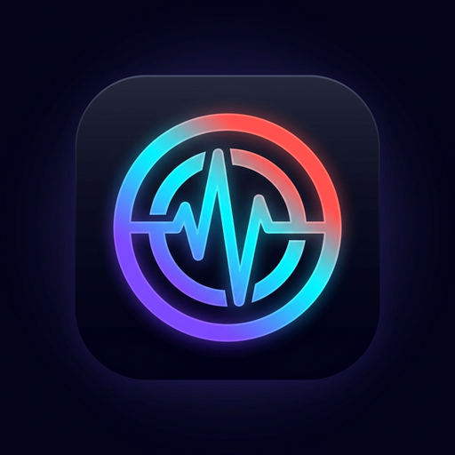

# PodPulse ⚡

<p align="center">
  
</p>

<p align="center">
  <b>A Next-Gen, Audiophile Podcast Client for Android</b><br>
  Built with Material You, AI Episode Summaries, Cloud Sync, and Audio Superpowers.
</p>

<p align="center">
  <a href="https://www.gnu.org/licenses/gpl-3.0"></a>
  
  
  
</p>

---

## 🌟 About PodPulse

**PodPulse** is a modernized, feature-packed evolution of the open-source podcast experience. It combines a state-of-the-art **Spotify / Pocket Casts inspired UI/UX**, real-time **Google-style wavy soundwave scrubbing**, **AI Episode Summaries**, **Hardware Loudness Enhancement (Voice Boost dB slider)**, and high-performance **PodPulse Cloud Sync**.

> [!NOTE]
> **Open Source Attribution & Lineage:**
> **PodPulse** is proudly built on the rock-solid foundation of [AntennaPod](https://github.com/AntennaPod/AntennaPod), the premier open-source podcast manager for Android. We honor and preserve AntennaPod's dedication to privacy, open standards (RSS/Atom), and absence of commercial tracking, while introducing a modern redesign, new audio DSP superpowers, and intelligent organization.
> 
> Licensed under the **GNU General Public License v3.0 (GPL-3.0)**.

---

## ✨ Key Enhancements & New Features

### 🎨 1. Obsidian Audio & Porcelain Sonic UI
- **Redesigned Player Screen:**
  - 24dp rounded hero artwork with overlapping frosted Info Badge (`ⓘ`) for instant show notes access.
  - Clear typographic hierarchy: Bold 20sp podcast title over secondary episode title.
  - Horizontal **Action Chips Row**: Quick Sleep Timer, Smart Share, Add to Queue, Dynamic Speed Chip, Download, and 1-tap Favorites.
  - Ergonomic controls with a prominent 64dp vibrant circular Play/Pause button with neon glow.
  - Floating bottom pill button for 1-tap navigation to the Up Next Queue.
- **Google-Style Wavy/Squiggly Progress Bar:**
  - Android 13/14 Pixel Media Player style sine-wave audio scrubber that undulates during playback and smoothly flattens on pause/drag.
- **Deep Midnight Obsidian Dark Mode:**
  - Replaces legacy greenish backgrounds with true midnight surfaces (`#10141A`, `#1C2026`) and vibrant high-contrast accents.

### 🧠 2. AI Episode Summaries (Gemini / Whisper)
- Dedicated AI Summary dialog (`AISummaryDialog`) that synthesizes long podcast episodes into executive bullet points, key timestamps, and actionable takeaways.
- 1-tap timestamp jumping to play directly from highlighted topics.

### 🔊 3. Audio Superpowers & Voice Boost Slider
- **Hardware LoudnessEnhancer:**
  - Fine-grained decibel gain slider (+0dB to +12dB) designed specifically for quiet spoken-word recordings.
  - Acoustically calibrated logarithmic millibel curve preventing clipping and audio distortion.

### 🔄 4. PodPulse Cloud Sync Architecture
- Built-in integration with the lightweight, high-performance PodPulse Sync backend (`sync-server/`) built with FastAPI, SQLite WAL, and Gpodder 2.0 protocol compliance.
- Supports multi-device playback synchronization and smart cloud queueing.

---

## 🛠️ Building & Compiling

PodPulse uses a modularized Gradle architecture.

### Prerequisites
- JDK 17 or higher
- Android SDK (API 34 / Build Tools 34.0.0)

### Build Debug APK:
```bash
./gradlew :app:assembleDebug
```
Output APKs will be located at:
- `app/build/outputs/apk/play/debug/app-play-debug.apk` (Recommended - includes Cast support)
- `app/build/outputs/apk/free/debug/app-free-debug.apk` (F-Droid / Google-free variant)

### Run Unit Tests:
```bash
./gradlew :app:testPlayDebugUnitTest
./gradlew :playback:service:test
```

---

## 📜 Credits & License

- **Base Project:** [AntennaPod](https://github.com/AntennaPod/AntennaPod) (Copyright © AntennaPod Contributors).
- **PodPulse Enhancements:** Created by Mohamed Kamel and contributors.
- **License:** Distributed under the [GNU General Public License v3.0](LICENSE).
